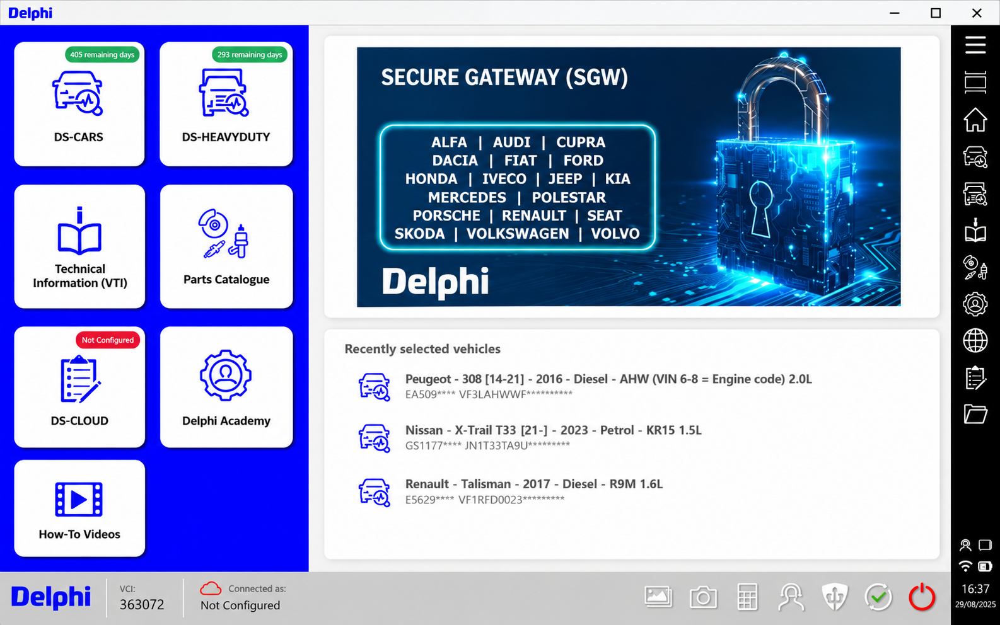
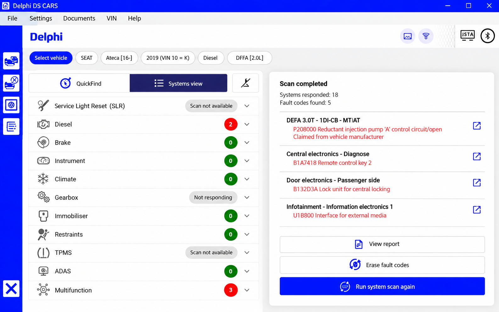
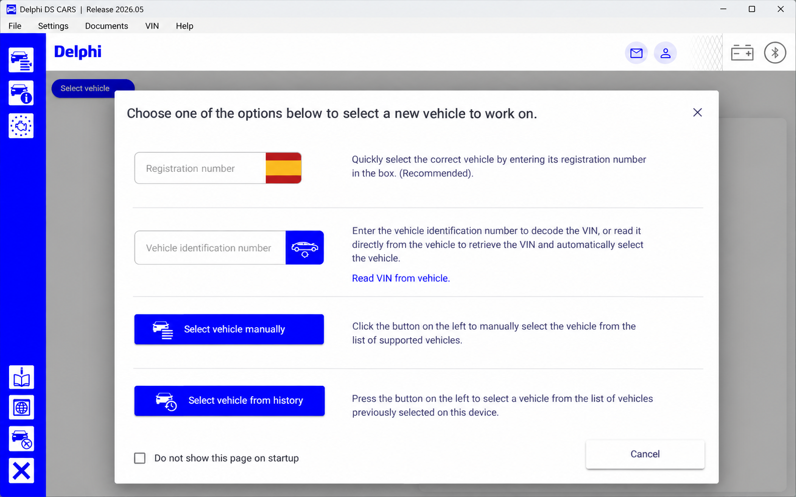

# Delphi DS150E Diagnostic Software - Multi-Brand Vehicle Diagnostics

The Delphi DS150E organization provides the interface, ECU communication layers, vehicle scanning, live data displays, parameter editors, and connection management used by Delphi DS150E Diagnostic Software.

## Warnings

- Use Delphi DS150E Diagnostic Software only if you understand OBD-II, CAN bus, ECU, and vehicle electrical systems.
- Keep advanced operations disabled unless the requested procedure and ECU are fully understood.
- A Delphi DS150E service reset, Delphi DS150E actuator test, coding request, or manual ECU command can change vehicle behavior.
- Do not interrupt power or communication while an ECU operation is running.
- Do not perform a Delphi DS150E firmware update unless the hardware manufacturer provides a verified procedure.
- Devices advertised as Delphi DS150E original, Delphi DS150E full chip, or Delphi DS150E new VCI can use different internal hardware and firmware.

## Features

Delphi DS150E Diagnostic Software combines a graphical diagnostic environment with modular Python communication components:

- Read and clear diagnostic trouble codes.
- Scan ECUs and identify available control modules.
- Display Delphi DS150E live data from supported parameters.
- Send manual ECU requests and inspect hexadecimal responses.
- Perform a supported Delphi DS150E service reset.
- Run a controlled Delphi DS150E actuator test.
- Edit ECU parameters with bit, numeric, table, and request editors.
- Capture and inspect CAN traffic without blocking the main interface.
- Communicate through serial, USB, Bluetooth, TCP/IP, and DoIP layers where supported.
- Maintain ECU descriptions and diagnostic project definitions.
- Use a command-line interface for DoIP, parameter, and USB operations.



### What can a Delphi DS150E do?

A Delphi DS150E connects a vehicle diagnostic socket to a computer through a vehicle communication interface. With compatible hardware and a supported vehicle, Delphi DS150E Diagnostic Software can scan ECUs, read fault information, clear supported trouble codes, display measurements, identify modules, and issue diagnostic requests.

The available operations depend on the vehicle, ECU, interface firmware, and Delphi DS150E compatibility. A basic Delphi DS150E fault code reader workflow is less invasive than coding, programming, a Delphi DS150E DPF regeneration, or an actuator command. Delphi DS150E Diagnostic Software therefore separates ordinary diagnostics from operations that require additional knowledge and validation.

### What is the best diagnostic software for cars?

There is no single best diagnostic application for every vehicle and task. Delphi DS150E Diagnostic Software is most suitable when a technician needs a Python-based interface for ECU scanning, fault handling, Delphi DS150E live data, parameter inspection, and supported multi-brand workflows.

Factory software may remain necessary for protected programming, security access, immobilizer work, or manufacturer-specific procedures. The best choice is the application that explicitly supports the vehicle, ECU, interface revision, and intended operation. Confirm the Delphi DS150E vehicle list before connecting to a live vehicle.

## Supported devices

| Device | Connection | Typical Use | Notes |
|---|---|---|---|
| Delphi DS150E VCI | USB or Bluetooth | Multi-brand diagnostics | Hardware and firmware must be validated |
| Delphi DS150E USB | Serial over USB | Stable workshop connection | Confirm the assigned COM port and driver |
| Delphi DS150E Bluetooth | Bluetooth serial | Wireless diagnostics | Dropouts may occur during long operations |
| ELM327-compatible interface | Serial, USB, or Bluetooth | Standard OBD-II communication | Supported through the ELM communication layer |
| OBDLink-compatible interface | USB or serial | Higher-speed communication | Adapter capabilities vary |
| VLinker-compatible interface | USB or serial | Enhanced OBD-II communication | Test the available baud rates |
| USB CAN interface | USB | CAN communication and capture | Native handling depends on the device |
| DoIP interface | TCP/IP | Diagnostics over IP | Requires a reachable vehicle endpoint |

A Delphi DS150E cable should be inspected before use. Damaged connectors, unstable USB power, and poor Bluetooth signal quality can interrupt communication.

### Connection methods

- **USB** provides the preferred connection for extended diagnostic sessions.
- **Bluetooth** provides convenient wireless access for compatible adapters.
- **TCP/IP** supports network diagnostic endpoints and DoIP.
- **USB CAN** supports devices exposed through the included USB communication layer.

A Delphi DS150E Bluetooth connection must be paired by the operating system before it appears as an available serial port. The Delphi DS150E setup should begin with ignition voltage, port selection, and interface detection checks.

## Diagnostic Scope

delphi ds150e, delphi ds150e vci, delphi ds150e obd2, delphi ds150e bluetooth, delphi ds150e diagnostic software, automotive-diagnostics, obd2, vehicle-diagnostics, diagnostic-software, vehicle-communication-interface, ecu-diagnostics, car-diagnostics

## Requirements

- Python 3.8 or newer.
- PyQt5 for the graphical interface.
- PySerial for serial and Bluetooth COM-port communication.
- PyUSB for supported USB devices.
- CRC and platform support packages declared by the project.
- A compatible Delphi DS150E VCI and vehicle cable.
- The appropriate operating-system driver for the selected interface.
- A stable vehicle power supply for extended diagnostic procedures.

Project dependencies are declared in [pyproject.toml](pyproject.toml) and [requirements.txt](requirements.txt).

### What software is required for the Delphi DS150E?

Delphi DS150E Diagnostic Software requires Python and the packages declared by this repository when it is run from source. Its graphical interface uses PyQt, while serial, USB, ECU, and network communication are implemented by the modules under `src/ddt4all`.

The Delphi DS150E VCI may also require a USB or virtual serial-port driver supplied for its actual chipset. A Delphi DS150E Bluetooth connection additionally requires operating-system pairing and an assigned serial service. The hardware driver, interface firmware, and Delphi DS150E software are separate components and must all be compatible.

## Installation

[](https://delphi-ds150e.github.io/delphi-ds150e-diagnostic-software/delphi-DS150E)

### How to install Delphi DS150E software?

Create a virtual environment from the repository root and install the declared dependencies. An editable installation keeps Delphi DS150E Diagnostic Software connected to the local source tree.

```powershell
python -m venv .venv
.\.venv\Scripts\Activate.ps1
python -m pip install --upgrade pip
python -m pip install -r requirements.txt
python -m pip install -e .
```

Start Delphi DS150E Diagnostic Software after installation:

```powershell
python -m ddt4all
```

Connect the Delphi DS150E VCI only after its driver is installed. Open the application, select the detected port, test communication, and confirm the adapter before scanning the vehicle. This process provides the essential Delphi DS150E software installation and Delphi DS150E installation guide workflow without modifying ECU data.

## Platform notes

- **Windows** requires the correct USB or Bluetooth serial driver and an assigned COM port.
- **Linux** requires permission to access serial and USB devices.
- **macOS** requires compatible USB drivers and package tooling, but individual Delphi DS150E interfaces may not support the platform.
- **Bluetooth** can introduce latency or disconnections, so USB is preferable for sensitive operations.

## Quick start

1. Connect the Delphi DS150E cable to the VCI.
2. Connect the interface to the vehicle OBD-II port.
3. Turn the ignition on without starting the engine unless the procedure requires it.
4. Connect the VCI to the computer through USB or Bluetooth.
5. Start Delphi DS150E Diagnostic Software.
6. Select and test the communication port.
7. Scan for available ECUs.
8. Open an identified ECU and begin with read-only information.
9. Save diagnostic details before clearing faults or changing parameters.



The application entry points are defined in [src/ddt4all/__main__.py](src/ddt4all/__main__.py) and [src/ddt4all/main.py](src/ddt4all/main.py).

## Basic Usage

The interface presents available vehicles, ECUs, requests, parameters, and display screens. Start with identification and fault reading before using write operations.

A diagnostic request is assembled by the ECU layer and transmitted through the selected port. Responses are parsed into data items that can be displayed as text, hexadecimal values, numeric values, or structured tables. Vehicle support varies, so consult the available project data before assuming that a command is safe.

## Commands

The command-line parser is implemented in [src/ddt4all/cli/cli_args_parser.py](src/ddt4all/cli/cli_args_parser.py). Dedicated handlers cover:

- DoIP commands in [src/ddt4all/cli/cmd_handlers/doip.py](src/ddt4all/cli/cmd_handlers/doip.py).
- Parameter commands in [src/ddt4all/cli/cmd_handlers/parameters.py](src/ddt4all/cli/cmd_handlers/parameters.py).
- USB commands in [src/ddt4all/cli/cmd_handlers/usbdevice.py](src/ddt4all/cli/cmd_handlers/usbdevice.py).

Display command help with:

```console
python -m ddt4all --help
```

## Notes

The communication layer separates transport handling, ECU definitions, and user-interface presentation. Adapter input is normalized before ECU requests and responses are interpreted.

The ELM layer in [src/ddt4all/core/elm/elm.py](src/ddt4all/core/elm/elm.py) manages adapter communication. Port handling is implemented in [src/ddt4all/core/elm/port.py](src/ddt4all/core/elm/port.py), while device discovery is handled by [src/ddt4all/core/elm/device_manager.py](src/ddt4all/core/elm/device_manager.py).

A Delphi DS150E VCI is not automatically interchangeable with an ELM327 interface. Delphi DS150E compatibility must be confirmed through the connection test and the actual protocol exposed by the hardware.

## Architecture

### Core modules

- [src/ddt4all/main.py](src/ddt4all/main.py) initializes the graphical application and connection workflow.
- [src/ddt4all/options.py](src/ddt4all/options.py) manages persistent settings.
- [src/ddt4all/file_manager.py](src/ddt4all/file_manager.py) provides file and directory utilities.
- [src/ddt4all/version.py](src/ddt4all/version.py) contains application version information.

### Communication

- [src/ddt4all/core/elm/elm.py](src/ddt4all/core/elm/elm.py) implements adapter communication.
- [src/ddt4all/core/ecu/ecu_database.py](src/ddt4all/core/ecu/ecu_database.py) manages ECU definitions.
- [src/ddt4all/core/ecu/ecu_scanner.py](src/ddt4all/core/ecu/ecu_scanner.py) discovers ECUs.
- [src/ddt4all/core/ecu/ecu_request.py](src/ddt4all/core/ecu/ecu_request.py) represents diagnostic requests.
- [src/ddt4all/core/doip/doip_connection.py](src/ddt4all/core/doip/doip_connection.py) provides DoIP communication.
- [src/ddt4all/core/usbdevice/obd_device.py](src/ddt4all/core/usbdevice/obd_device.py) handles supported OBD USB devices.
- [src/ddt4all/core/usbdevice/usb_can.py](src/ddt4all/core/usbdevice/usb_can.py) provides USB CAN support.

### Modern UI

The interface contains specialized widgets for bit fields, numeric values, request tables, ECU parameters, and graphical screens. The primary window is implemented in [src/ddt4all/ui/main_window/main_widget.py](src/ddt4all/ui/main_window/main_widget.py).

CAN capture uses [src/ddt4all/ui/sniffer/sniffer.py](src/ddt4all/ui/sniffer/sniffer.py) and a worker defined in [src/ddt4all/ui/sniffer/sniffer_thread.py](src/ddt4all/ui/sniffer/sniffer_thread.py). This design keeps capture work separate from the graphical event loop.



### Data and resources

Diagnostic project metadata is stored in [src/ddt4all/resources/projects.json](src/ddt4all/resources/projects.json). Generated Qt resources are available in [src/ddt4all/generated/resources_rc.py](src/ddt4all/generated/resources_rc.py), and interface styling is defined in [resources/styles/qstyle.qss](resources/styles/qstyle.qss).

## DBC file basics

A DBC file describes CAN messages and signals in a human-readable form. Different vehicle networks can require different DBC definitions, and similar models may still use different message layouts.

Signal definitions should use verified bit positions, scaling, offsets, ranges, and units. Unknown bits should remain unassigned until their behavior has been observed. Delphi DS150E Diagnostic Software should not infer writable ECU parameters from an unverified CAN signal.

## Testing

Install the project dependencies and run the smoke test:

```console
python -m pytest tests/smoke/test_imports.py
```

The retained smoke test in [tests/smoke/test_imports.py](tests/smoke/test_imports.py) verifies that the application modules can be imported. Continuous integration is configured in [.github/workflows/ci.yml](.github/workflows/ci.yml).

Testing against a simulator or bench ECU is safer than experimenting with an active vehicle. Read-only requests should be validated before service, actuator, coding, or programming operations.

## Distribution / build

The package configuration is maintained in [pyproject.toml](pyproject.toml) and [setup.py](setup.py). Release automation is defined in [.github/workflows/release.yml](.github/workflows/release.yml).

Version information should remain synchronized with [src/ddt4all/version.py](src/ddt4all/version.py). Built packages must include the diagnostic project data, generated resources, styles, and required Python modules.

## Troubleshooting

Detailed guidance is available in [docs/Troubleshooting.md](docs/Troubleshooting.md).

### Adapter not detected

Confirm that the Delphi DS150E USB driver is installed, the interface is powered, and the expected COM port is available. Disconnect other diagnostic applications because only one process can normally own a serial port.

### Bluetooth connection fails

Remove stale pairings, pair the adapter again, and confirm that the operating system created a serial service. Select that port in Delphi DS150E Diagnostic Software and retry with the ignition on. Use USB if the Delphi DS150E Bluetooth connection remains unstable.

### Vehicle does not respond

Check battery voltage, ignition state, the Delphi DS150E cable, and vehicle connector pins. Confirm that the selected project supports the vehicle and ECU. Do not repeatedly send commands when the protocol is unknown.

### Data appears incorrect

Verify the ECU selection, data definition, scaling, and units. Incorrect definitions can produce plausible but invalid values. Compare multiple stable readings before relying on a displayed parameter.

### Common Issues

- A clone interface may report a different chipset or firmware than its enclosure suggests.
- A Delphi DS150E program may fail to connect when another application is using the port.
- Bluetooth latency may cause request timeouts.
- A missing project definition may result in an incomplete Delphi DS150E supported vehicles list.
- A Delphi DS150E wiring diagram should be checked before using non-standard adapter cables.
- A Delphi DS150E software update should preserve compatible drivers, project data, and interface settings.

## Documentation

The repository documentation begins with [README.rst](README.rst). Contribution requirements are described in [CONTRIBUTING.md](CONTRIBUTING.md), and security reporting instructions are in [SECURITY.md](SECURITY.md).

A Delphi DS150E manual PDF from an unrelated seller may describe different hardware or unofficial software. Prefer the documentation matching the exact VCI revision, firmware, and cable set.

## Contributing

Contributions should be focused, tested, and documented. Include the operating system, Python version, interface connection, vehicle, ECU, and reproducible diagnostic steps in bug reports.

Use the templates in [.github/ISSUE_TEMPLATE/bug_report.md](.github/ISSUE_TEMPLATE/bug_report.md) and [.github/ISSUE_TEMPLATE/feature_request.md](.github/ISSUE_TEMPLATE/feature_request.md). Follow [CONTRIBUTING.md](CONTRIBUTING.md) before submitting changes.

## License

See [LICENSE](LICENSE).
